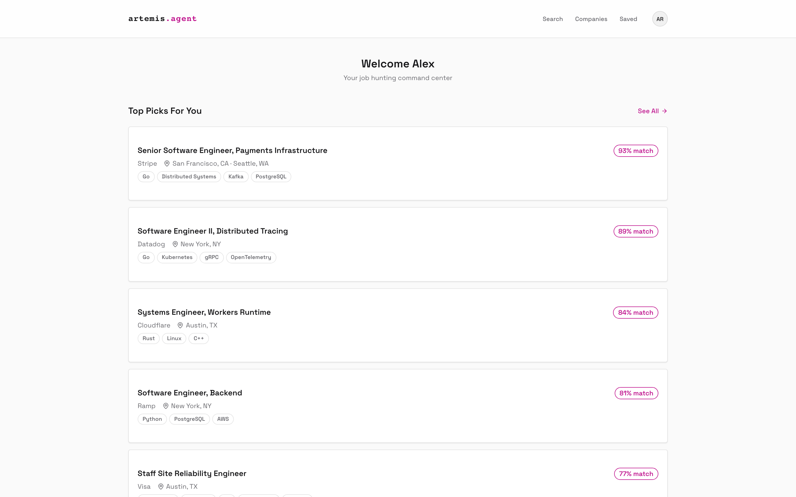

# artemis-worker

Python engine behind [Artemis](https://github.com/artemis-agent), a job platform that scrapes openings directly from company applicant tracking systems (ATS) and ranks them against your resume. This repo finds companies' career sites, detects which ATS each one uses, scrapes their jobs, enriches them with an LLM and embeddings, tracks changes, and computes recommendations.



## Pipeline

1. **Discovery.** A discovery agent searches for a company's careers page (DuckDuckGo), extracts the ATS type and board identifier from result URLs, confirms jobs exist by probing the ATS API, and falls back to the LLM when no URL pattern matches or a match looks wrong. It writes a scraper config to `configs/companies/<slug>.yaml`. Companies come from seed sources (Fortune 500, Cloud 100, YC, Crunchbase) or on demand via `artemis hunt`.
2. **Scraping.** Each company is scraped by the scraper registered for its ATS. Jobs are upserted with new/updated counts per run, and new jobs are queued for enrichment.
3. **Enrichment.** Queued jobs are flushed in batches: an LLM normalizes each posting into structured fields (seniority, skills, location, and so on), writes a one-line summary, and an embedding is stored in pgvector.
4. **Monitoring.** A liveness checker re-checks active jobs against each ATS's single-job endpoint (falling back to the job URL) and publishes status changes to a Redis Stream (`artemis:events:job_changes`).
5. **Recommendations.** Candidates are pulled by vector similarity to the user's resume embedding, then re-ranked on skill overlap, skill category, location, seniority, desired role, and recency. Results are cached in Redis.

Supported ATS scrapers: Greenhouse, Lever, Ashby, Workday, SmartRecruiters, Eightfold, iCIMS, plus a generic fallback. The repo ships 1,288 company configs in `configs/companies/`.

## Where it fits

```text
artemis-web --> artemis-api (Go) --HTTP--> artemis-worker internal API (:8081)   <-- this repo
                     |                          |
                     |                    Celery workers: scrape / enrich / monitor  (+ beat schedule)
                     |                          |
                     +--- PostgreSQL + pgvector, Redis, MinIO ---+
```

[artemis-api](https://github.com/artemis-agent/artemis-api) calls the internal API for embeddings, recommendations, resume parsing, scrape triggers, and company hunts. This repo also owns the database schema (`artemis init-db`).

Internal API routes (`artemis/api/routes/`): `GET /healthz`; `POST /internal/scrape`, `/internal/embed`, `/internal/monitor/trigger`, `/internal/hunt`, `/internal/discover`, `/internal/resume/parse`, `/internal/recommend`, `/internal/user/embed`; `GET /internal/resume/progress`.

Celery beat schedule (`artemis/core/celery_app.py`): scrape all companies and flush enrichment every 30 minutes, run the liveness monitor every 2 minutes, and run agent discovery daily at 03:00 UTC.

## Stack

Python 3.12, SQLAlchemy 2 (async) + asyncpg, PostgreSQL 16 with pgvector, Celery with Redis, Redis Streams, Starlette + Uvicorn, Azure OpenAI (chat + embeddings), httpx + BeautifulSoup, MinIO/S3 via aioboto3, pdfplumber, Click, pytest, ruff.

## Run locally

### Docker Compose (everything)

```bash
cp .env.example .env      # fill in the Azure OpenAI values
docker compose up -d
```

This starts PostgreSQL (pgvector), Redis, MinIO, the internal API on `:8081`, the `scrape`, `enrich`, and `monitor` Celery workers, and Celery beat. Initialize the database and load company configs from the `app` container:

```bash
docker compose exec app artemis init-db
docker compose exec app artemis sync-configs
```

### Python on the host

```bash
docker compose up -d postgres redis minio
python -m venv .venv && source .venv/bin/activate
pip install -e ".[dev]"
cp .env.example .env

artemis init-db           # tables, indexes, pgvector extension
artemis sync-configs      # load configs/companies/*.yaml into the DB
artemis serve-internal    # internal API on :8081

# workers, one per terminal (same commands as docker-compose.yml)
celery -A artemis.core.celery_app worker -Q scrape -c 2 --loglevel=info -n scrape@%h
celery -A artemis.core.celery_app worker -Q enrich -c 1 --loglevel=info -n enrich@%h
celery -A artemis.core.celery_app worker -Q monitor -c 1 --loglevel=info -n monitor@%h
celery -A artemis.core.celery_app beat --loglevel=info
```

### CLI

Run `artemis --help` for all options.

| Command | Purpose |
| --- | --- |
| `artemis hunt <company> [--url <careers_url>]` | Find careers page, detect ATS, write config |
| `artemis detect <careers_url>` | Detect the ATS type for a URL |
| `artemis discover --source fortune500\|cloud100\|yc\|crunchbase [--agent]` | Batch discovery from a source, or the autonomous agent |
| `artemis scrape <slug>` / `artemis scrape-all` | Scrape one company / all active companies |
| `artemis enrich [--slug <slug>]` | Normalize and embed unenriched jobs |
| `artemis flush` | Flush the enrichment queue |
| `artemis enrich-cb` | Backfill company metadata from Crunchbase |
| `artemis monitor` | Check active jobs for liveness |
| `artemis events [--follow] [--info]` | Read job change events from the Redis Stream |

### Configuration

Settings load from `.env` via pydantic-settings with the `ARTEMIS_` prefix (`artemis/core/config.py`). From `.env.example`:

| Variable | Purpose |
| --- | --- |
| `ARTEMIS_DATABASE_URL` | Async PostgreSQL URL (`postgresql+asyncpg://...`) |
| `ARTEMIS_REDIS_URL` | Redis for Celery, the enrichment queue, streams, and caches |
| `ARTEMIS_AZURE_OPENAI_API_KEY`, `ARTEMIS_AZURE_OPENAI_ENDPOINT`, `ARTEMIS_AZURE_OPENAI_API_VERSION` | Primary Azure OpenAI deployment |
| `ARTEMIS_AZURE_OPENAI_API_KEY_2`, `ARTEMIS_AZURE_OPENAI_ENDPOINT_2` | Optional second deployment; requests round-robin and fail over on 429 |
| `ARTEMIS_LLM_MODEL`, `ARTEMIS_EMBEDDING_MODEL` | Defaults `gpt-4.1` and `text-embedding-3-small` |
| `ARTEMIS_CRUNCHBASE_API_KEY` | Crunchbase discovery and enrichment |

S3/MinIO settings (`ARTEMIS_S3_ENDPOINT`, `ARTEMIS_S3_ACCESS_KEY`, `ARTEMIS_S3_SECRET_KEY`, `ARTEMIS_S3_BUCKET`) default to the docker-compose MinIO.

### Tests and lint

```bash
ruff check . && ruff format --check .
pytest tests/test_registry.py     # unit tests
pytest tests/test_scrapers.py     # hits live ATS APIs
```

## Project layout

```text
artemis/
  cli.py          Click CLI
  core/           settings, DB models, async session, AI client, prompts, Celery app, Redis
  discovery/      discovery agent, ATS detector, probes, search, seed sources
  scrapers/       base class, registry, ats/ (one module per ATS)
  services/       scrape, enrich, hunt, monitor, user (resume + recommendations)
  workers/        Celery tasks: scrape, enrich, monitor
  monitor/        liveness checker, Redis Streams events
  normalizer/     rules, skill taxonomy
  resume/         MinIO/S3 storage
  api/            internal Starlette API routes
configs/companies/  one YAML scraper config per company
scripts/            ad-hoc discovery and debugging scripts
tests/
```

## Related repos

| Repo | Role |
| --- | --- |
| [artemis-web](https://github.com/artemis-agent/artemis-web) | Next.js frontend |
| [artemis-api](https://github.com/artemis-agent/artemis-api) | Go HTTP API: auth, search, companies, saved jobs, resume upload |
| [artemis-worker](https://github.com/artemis-agent/artemis-worker) | Python engine (this repo) |
